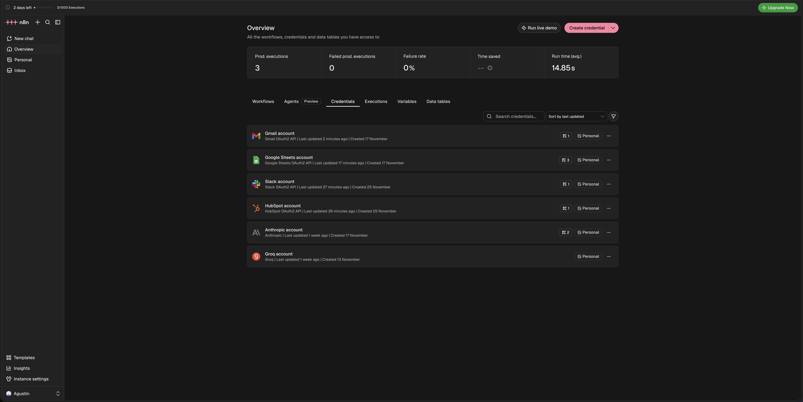
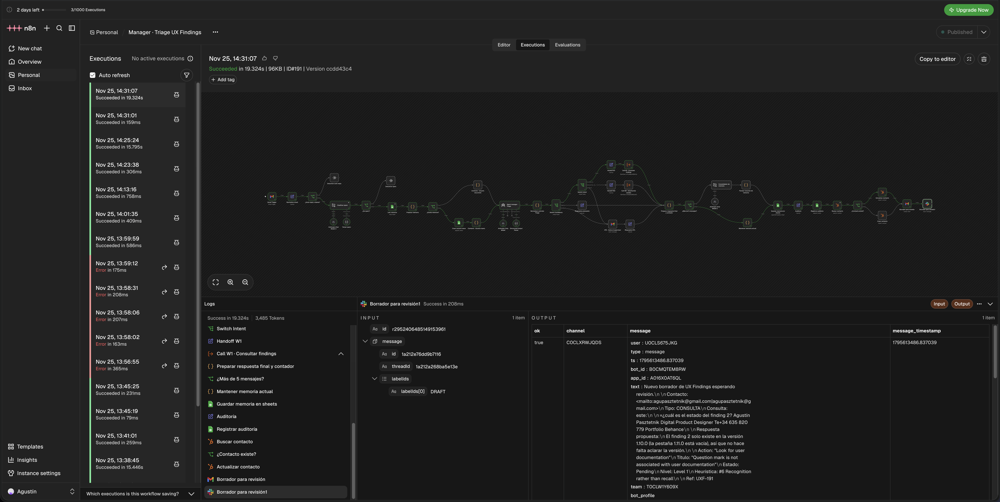

# UX Findings · Agente Integrador (Checkpoint 4 · Módulo 4)

Sistema multi-agente en n8n que atiende el buzón de consultas del equipo de producto sobre los findings de user testing. Recibe los mails, los clasifica, responde desde la planilla de findings o registra solicitudes de cambio, deja la respuesta como borrador para revisión humana, actualiza la ficha del contacto en el CRM y avisa al equipo por Slack.

## 1. Qué hace

El agente escucha una casilla de Gmail (`agupasztetnik+ux@gmail.com`). Ante cada mail nuevo:

1. Filtra correos automáticos y spam antes de procesar nada.
2. Clasifica la intención (consulta, solicitud de cambio o fuera de alcance).
3. Según el caso, consulta la planilla de findings (Worker 1) o registra una solicitud de cambio (Worker 2).
4. Redacta la respuesta y la deja como **borrador** en el hilo original de Gmail, para que una persona la revise y la envíe.
5. Registra la interaccion en una auditoría (Google Sheets) y actualiza la ficha del contacto en el CRM (HubSpot).
6. Avisa al canal del equipo en Slack que hay un borrador esperando aprobación.

El caso no es de e-commerce: es un buzón interno de soporte sobre findings de UX. La persona que escribe no es un cliente, es quien consulta o pide cambios sobre los hallazgos (devs, QA, PO, PM, diseño).

## 2. Por qué sobre el proyecto integrador

La consigna permitía resolver el checkpoint con un mini flujo nuevo. Se decidió seguir construyendo sobre el flujo del Módulo 3 para mantener un **proyecto integrador** que crece módulo a módulo, en lugar de un ejercicio aislado. Por eso los nuevos nodos (barrera de entrada, CRM, Create Draft y Slack) se integran a la arquitectura multi-agente existente y no a un flujo lineal creado para la ocasión.

## 3. Arquitectura

El sistema es multi-agente, a diferencia del diagrama monolítico de la consigna (un solo agente en línea recta). Se compone de un Manager y dos Workers, con memoria conversacional en Google Sheets.

- **Manager · Triage UX Findings:** recibe el mail, aplica la barrera de entrada, clasifica la intención, delega al worker correspondiente, consolida la respuesta y dispara las escrituras (auditoría, CRM, borrador, Slack).
- **Worker 1 · Consultar findings:** responde consultas de solo lectura sobre la planilla de findings.
- **Worker 2 · Solicitud de cambio:** registra pedidos de cambio sobre un finding en la planilla de solicitudes.

```
[Gmail Trigger]
      |
[Normalizar email]
      |
[Barrera: IF auto-reply]--(auto)--> descartar
      |
[Clasificar spam (LLM)]
      |
[IF spam]--(spam)--> descartar
      |
[Memoria] -> [Agent Manager: Triage] -> [Switch intent]
                                             |-- CONSULTA ---------> [Call W1]
                                             |-- SOLICITUD_CAMBIO --> [Call W2]
                                             |-- fuera de alcance --> respuesta de aclaración
      |
[Auditoría (Set)] -> [Registrar auditoría (Sheets)]
      |
[Buscar contacto (Look up)] -> [IF contacto existe]
                                   |-- si  --> [Actualizar contacto]
                                   |-- no  --> [Crear contacto]
      |
[Borrador para revisión (Gmail Draft)]
      |
[Aviso a Slack]
```

## 4. Los cuatro guardrails que evalúa la rúbrica

### ① Barrera anti auto-reply y spam

Después del trigger, antes de procesar, hay dos filtros encadenados:

- **IF determinista `¿Auto-reply o rebote?`** (modo OR, Ignore Case): descarta correos cuyo asunto o remitente indican respuesta automática o rebote (`auto-reply`, `out of office`, `respuesta automática`, `fuera de la oficina`, `undeliverable`, `no-reply@`, `mailer-daemon@`, `postmaster@`).
- **Clasificador de spam (LLM)**: un modelo evalúa si el mail es ajeno al propósito del buzón (promoción, phishing, newsletter, ventas). Si lo es, se descarta.

Los correos descartados no disparan ninguna acción (No Operation), ni siquiera un aviso. Así se corta el bucle infinito de auto-respuestas antes de que llegue al CRM o a la casilla.

### ② Look up antes de crear en el CRM

Antes de escribir en HubSpot, el nodo **`Buscar contacto`** hace una búsqueda por email (Look up explícito). Un IF evalúa si el contacto ya existe:

- Existe (recurrente): rama **Actualizar contacto**.
- No existe (nuevo): rama **Crear contacto**.

Esto evita el error 409 (contactos duplicados). El nodo nativo de HubSpot solo ofrece la operación "Create or Update" (upsert), así que se duplicó el nodo para que cada rama escriba campos distintos y el IF tenga sentido funcional real.

### ③ Create Draft (Human-in-the-loop)

El nodo de salida de correo **`Borrador para revisión`** usa la operación **Draft / Create** en lugar de responder directamente. La respuesta del agente queda como borrador en el hilo original del mail, y nada se envía hasta que una persona lo revisa y hace clic en Enviar. Es el guardrail humano antes del envío.

A diferencia de un Reply, el Draft/Create exige asunto propio (`Re: {asunto original}`) y necesita el **Thread ID** del mail para quedar dentro del hilo y no como un borrador suelto.


### ④ Set de limpieza de payload antes de Slack

El aviso a Slack no recibe el objeto crudo del mail (que arrastra binarios, HTML y metadatos pesados). Lee del nodo **`Auditoría`**, un Set con campos planos (contacto, tipo, consulta, respuesta, referencia). Ese Set cumple el rol de limpieza de payload: evita el "pasillo de la muerte" y el error 400 por datos mal formados.


## 5. El CRM como directorio del equipo

El hilo conductor de la consigna es que importa el rol de cada pieza, no la marca. El rol del CRM es ser la fuente donde viven los datos de la persona que escribe, para saber si ya la conocemos o es nueva.

En este proyecto el CRM no es de ventas: es un **directorio de contactos del equipo de producto**. La ficha de cada contacto guarda su rol (dev, QA, PO, PM, diseño), su squad, la cantidad de interacciones, la última vez que escribió y el tipo de su último pedido. Para eso se crearon cinco propiedades personalizadas en el objeto Contacto (`ux_rol`, `ux_equipo`, `ux_num_interacciones`, `ux_ultima_interaccion`, `ux_ultimo_tipo`).

Google Sheets y HubSpot conviven, no se reemplazan: Sheets guarda la **memoria conversacional** y la auditoría; HubSpot guarda la **ficha de la persona**. El Look up por email decide si el contacto es nuevo o recurrente.

## 6. Las tres integraciones (OAuth2 y mínimo privilegio)

Las tres herramientas que pide la consigna están conectadas por OAuth2, cada una en su rol:

- **HubSpot** (CRM): lectura y escritura de contactos.
- **Gmail** (casilla de correo): trigger de entrada y Create Draft de salida.
- **Slack** (canal del equipo): aviso de borrador pendiente.

Cada nodo mapea solo los campos estrictamente necesarios para su función (mínimo privilegio). El `.json` exportado no contiene los secretos de las credenciales, solo la referencia a ellas, por eso se adjunta la captura de la sección Credentials como evidencia de que las conexiones están activas.



Detalle de cada conexión (semáforo en verde):


## 7. Decisiones técnicas y errores resueltos

**GDPR y base legal en HubSpot.** El portal europeo exige una base legal al crear contactos. Sin ella, el alta devuelve error 400. El nodo de creación envía `hs_legal_basis = Legitimate interest - other`.

**Clasificador de spam que devolvía texto vacío.** El modelo liviano usado para clasificar gastaba sus tokens en razonamiento interno y devolvía texto vacío al parser, cortando el flujo. Se resolvió acortando el prompt y agregando `On Error -> Continue` en el nodo, de modo que un fallo del clasificador no frene el procesamiento del mail. Es un ejemplo del criterio de contención de errores que evalúa el checkpoint.

**Formato de fecha en HubSpot (INVALID_DATE).** Las propiedades de tipo fecha exigen el timestamp en milisegundos a medianoche UTC exacta. `$now.startOf('day')` devuelve medianoche local (en Madrid, las 23:00 UTC del día anterior) y HubSpot lo rechaza. Se corrigió con `{{ $now.toUTC().startOf('day').toMillis() }}`.

**Ejecución de regresión.** Antes de exportar se corrió el flujo completo de punta a punta, verificando cada nodo en verde.



## 8. Cómo importar y probar

1. Importar los tres workflows en n8n (el Manager y los dos Workers).
2. Asignar las credenciales propias en cada nodo que las requiera (el export no las trae; cada nodo queda marcado con credencial faltante hasta asignarla).
3. Re-vincular los nodos `Call W1` y `Call W2` del Manager a los Workers importados. Al importar, n8n asigna IDs nuevos a los workflows, así que la referencia hay que volver a elegirla del desplegable.
4. Ejecutar nodo por nodo con Execute step y verificar el semáforo en verde antes de activar.

## 9. Contenido del repositorio

- `checkpoint4_agustin_pasztetnik.json` — workflow principal (Manager · Triage UX Findings). Contiene los cuatro nodos que evalúa la rúbrica.
- `W1 · Consultar findings.json` — Worker 1 (consulta de findings).
- `W2 · Solicitud de cambio.json` — Worker 2 (registro de solicitudes).
- `Assets/` — capturas de pantalla referenciadas en este README.
